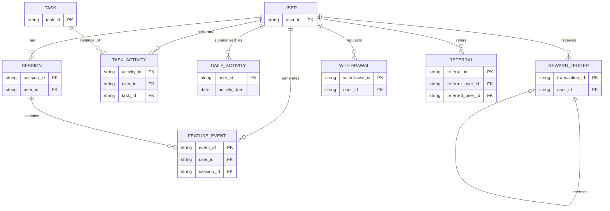

# Logical Data Model & ER Diagram

User-to-session/event/task/reward/withdrawal are one-to-many. Session-to-event is one-to-many. Task-to-task activity is one-to-many. Referral has two role-playing user references. Reward reversal self-references original transaction. Daily activity grain is one user per date. Proposed entities require engineering validation.
