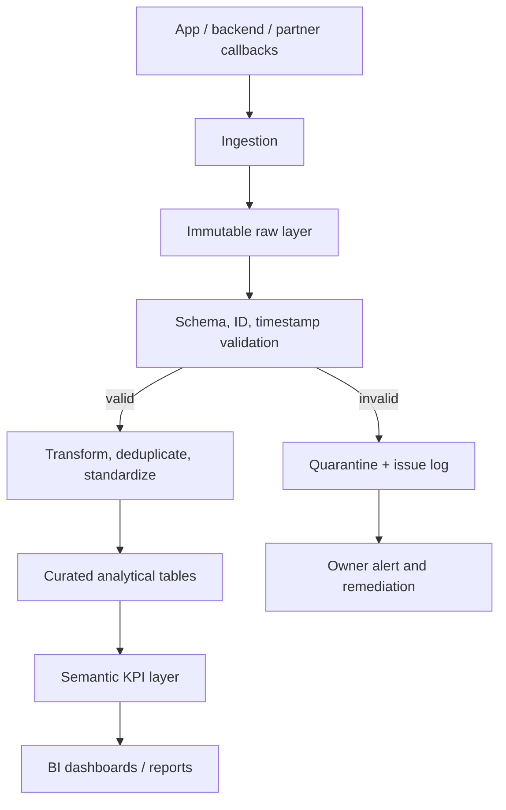

# Data Pipeline Proposal

Start with scheduled batch exports if volume/latency allows; add streaming only when justified. Keep raw data immutable, transformations reproducible and metric logic version-controlled. Engineering owns producers; Data owns transformations and quality; Finance/Operations own transaction state reconciliation; BI owns semantic models and reporting. Monitor freshness, volume, schema drift, duplicate IDs, null required fields, orphan references and refresh failures.
